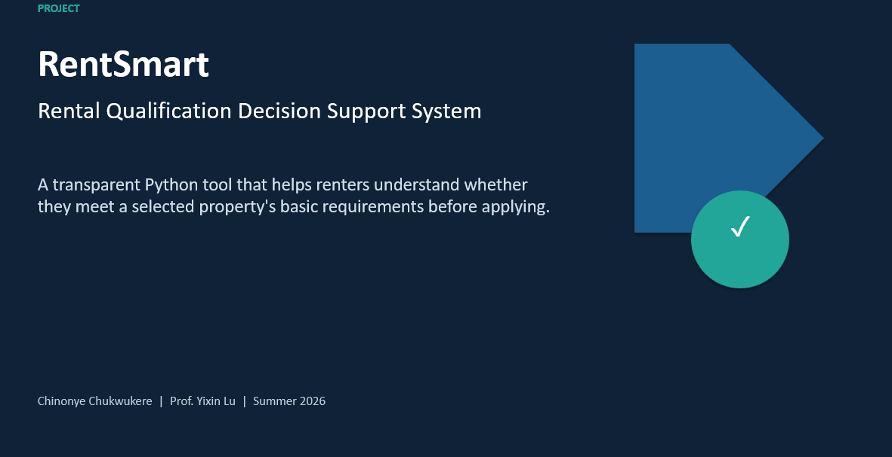
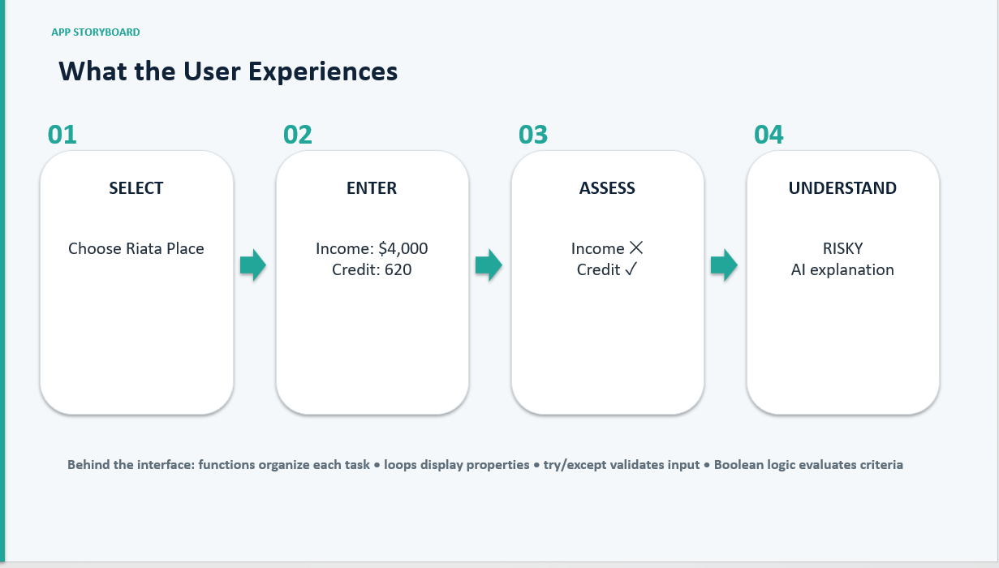

# RentSmart
### AI-Assisted Rental Qualification Decision Support System

**Know Before You Apply.**

RentSmart is a Python-based decision support system designed to help renters understand whether they meet a selected rental property's basic qualification requirements before submitting an application.

The solution combines transparent business rules, structured property data, automated qualification assessments, and Google Gemini AI to provide understandable, actionable results.

## The Business Problem

Renters often apply for properties without fully understanding the income and credit requirements. This can lead to unnecessary application fees, wasted time, and uncertainty.

**RentSmart addresses this problem by providing a preliminary qualification assessment before the renter decides to apply.**

## How RentSmart Works

1. The renter selects a property from the available property records.
2. The renter enters monthly income and credit score.
3. Python retrieves the property's requirements from a CSV file.
4. The qualification engine calculates required income and evaluates both criteria.
5. The system assigns a qualification status.
6. Google Gemini AI explains the result in plain language.
7. The renter receives a qualification report and recommendation.

**Python decides. AI explains.**

## Core Features

| Feature | Description |
|---|---|
| Property Selection | Select a property from stored records. |
| Applicant Input | Enter monthly income and credit score with input validation. |
| Qualification Engine | Compare applicant information against property requirements. |
| Risk Classification | Identify whether both, one, or neither requirement is met. |
| Gemini AI Integration | Generate understandable explanations of Python's assessment. |
| Qualification Report | Display pass/fail criteria, qualification status, and recommendations. |

## Qualification Outcomes

**Likely Qualified:** Both income and credit requirements are met.

**Risky:** Only one requirement is met.

**Not Qualified:** Neither requirement is met.

These are preliminary assessments, not official rental approval decisions.

## Technology Stack

- **Python:** Application development and business logic.
- **CSV:** Property requirements and data management.
- **Google Gemini API:** AI-generated explanations.
- **Python Functions:** Modular application design.
- **Conditional and Boolean Logic:** Qualification decisions.
- **Exception Handling:** Input validation.

## System Architecture

Renter Input → CSV Property Requirements → Python Qualification Engine → Qualification Status → Gemini AI Explanation → Final Report

The Python engine determines qualification status using predefined rules. Gemini explains the completed assessment without changing the decision.

## Example Use Case

**Selected Property:** Riata Place

- Monthly rent: $1,400
- Income requirement: 3× monthly rent
- Required monthly income: $4,200
- Minimum credit score: 600

**Applicant Information**

- Monthly income: $4,000
- Credit score: 620

**Assessment**

- Income requirement: FAIL
- Credit requirement: PASS
- Final status: RISKY

The system identifies the income shortfall and provides an AI-assisted explanation to help the renter understand the result.

## Project Documentation

This repository contains:

- `python-code/` — Python application and supporting files.
- `presentation/` — Project presentation and demonstrations.
- `screenshots/` — Project visuals and application screenshots.
- `docs/` — Technical documentation and system design.

## Project Scope

RentSmart assesses one applicant against one selected property's predefined requirements.

It does not search live rental websites, guarantee approval, or replace a property's official screening process.

## Project Development

**Project:** RentSmart — Rental Qualification Decision Support System

**Developer:** Chinonye V. Chukwukere

**Focus Areas:** Business Analysis, Python Development, AI Integration, System Design, Requirements Engineering, and Decision Support Systems.

